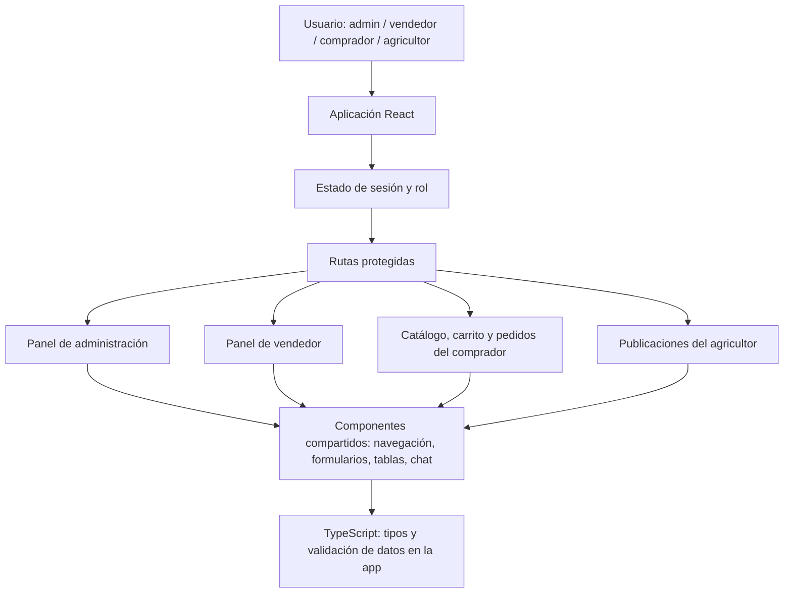
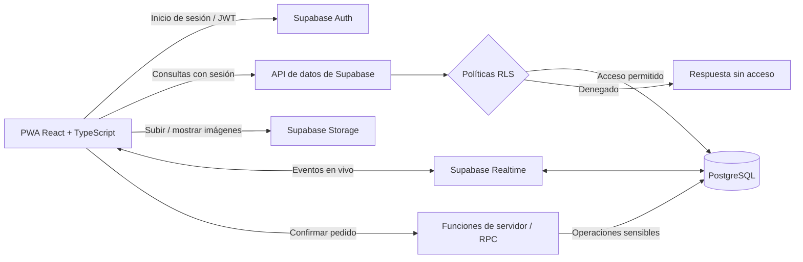
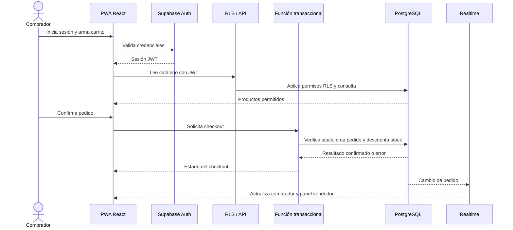
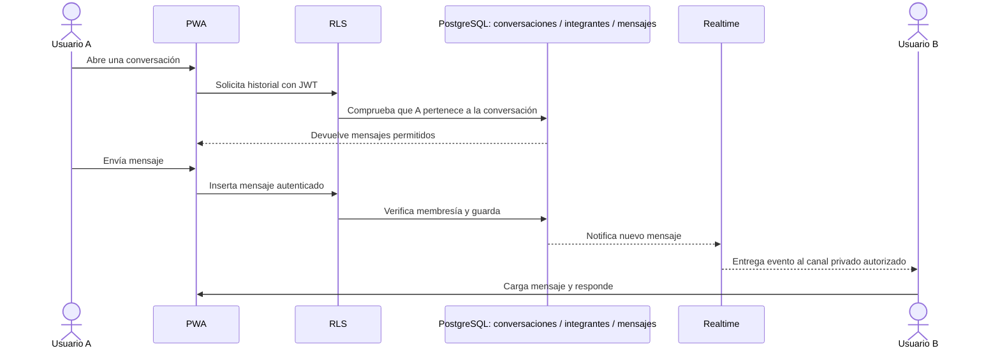

# Arquitectura propuesta para la PWA de Rassa

## Tecnologías

- **React** organiza la interfaz en componentes reutilizables y pantallas. La misma aplicación presenta navegación distinta según el rol autenticado: administrador, vendedor, comprador y, si se incluye, agricultor.
- **TypeScript** añade tipos a usuarios, productos, pedidos, mensajes y respuestas de Supabase. Ayuda a detectar errores durante el desarrollo; no sustituye validaciones ni controles de acceso.
- **Supabase** aporta PostgreSQL, Auth, Storage y Realtime. La PWA se conecta usando el SDK oficial. Las tablas expuestas deben protegerse con RLS; las claves secretas nunca deben incluirse en el navegador.

## Diagrama 1: organización de la PWA en React



### Proceso

1. React inicia la aplicación y comprueba si hay una sesión válida.
2. La app obtiene el perfil y rol del usuario.
3. El enrutador muestra el panel que corresponda y protege las pantallas que requieren sesión.
4. Componentes compartidos presentan datos y formularios; TypeScript comprueba sus formas mientras se desarrolla.
5. Las reglas de permisos no se confían a la interfaz: Supabase vuelve a comprobarlas en la base de datos.

## Diagrama 2: servicios de Supabase



### Proceso

1. **Auth** valida credenciales y entrega una sesión/JWT.
2. La PWA usa la sesión para consultar datos; PostgreSQL evalúa las políticas RLS para cada operación y fila.
3. El catálogo, perfiles, publicaciones, pedidos, pagos, conversaciones y mensajes se guardan en PostgreSQL. Las imágenes y adjuntos se guardan en Storage.
4. Realtime notifica cambios a clientes autorizados, por ejemplo mensajes nuevos o cambios de estado del pedido.
5. Las operaciones críticas (por ejemplo, validar stock y crear pedido en una sola transacción) se ejecutan mediante una función de servidor o función SQL/RPC, no mediante una secuencia de escrituras independientes desde el navegador.

## Diagrama 3: recorrido de un pedido



### Proceso

El comprador arma el carrito con productos que puede consultar. Al confirmar, la función de servidor vuelve a validar precio y disponibilidad, crea el pedido y descuenta existencias como una operación atómica. Si algo falla, no se deja un pedido a medias. Después, Realtime avisa a las pantallas autorizadas para que comprador y vendedor vean el estado actualizado.

## Diagrama 4: chat en tiempo real



### Proceso

Cada conversación tiene integrantes registrados. Las políticas de base de datos permiten consultar e insertar mensajes solo a esos integrantes. Realtime distribuye la actualización a quienes tengan permiso sobre esa conversación. El historial queda persistido en PostgreSQL; el canal en vivo solo comunica novedades.

## Diagrama separado: vista general de la arquitectura

La imagen independiente [arquitectura-rassa.svg](./arquitectura-rassa.svg) resume los actores, la PWA, el control de acceso y los servicios de Supabase en una sola vista.

## Organización inicial sugerida

```text
src/
  app/              # rutas, sesión y composición general
  components/       # componentes reutilizables
  features/
    auth/
    catalog/
    orders/
    chat/
    admin/
    seller/
    buyer/
  lib/supabase.ts   # cliente Supabase
  types/            # tipos compartidos
supabase/
  migrations/       # esquema, índices y políticas RLS versionadas
  functions/        # operaciones de servidor cuando se requieran
```

## Decisiones y límites

- Una sola PWA con rutas y vistas por rol reduce duplicación; el rol de la interfaz es solo una ayuda visual, mientras que RLS y funciones validan autorización real.
- Para chat de texto básico, PostgreSQL + Realtime evita añadir otro proveedor. Adjuntos se guardarían en Storage con permisos por conversación.
- Supabase simplifica infraestructura, pero no elimina el diseño de permisos. Cada tabla expuesta necesita políticas concretas; nunca se debe poner la clave `service_role` en React.
- La PWA puede cachear recursos estáticos para abrir rápido y ofrecer parte de la interfaz sin conexión. Pedidos, pagos y chat requieren conexión para confirmar el estado del servidor.
