# Diagrama físico de la base de datos · Rassa JALA

Motor PostgreSQL de Supabase. Las flechas representan FK (hija → padre); `auth.users` es la tabla administrada por Supabase Auth.

Se usa tema oscuro para mantener texto claro sobre entidades oscuras y que las líneas de relación destaquen.

```mermaid
---
config:
  theme: base
  themeVariables:
    darkMode: true
    primaryColor: '#173B55'
    primaryTextColor: '#FFFFFF'
    primaryBorderColor: '#69C6F0'
    lineColor: '#F3B94F'
    secondaryColor: '#1E594B'
    tertiaryColor: '#27384A'
    background: '#101820'
    mainBkg: '#173B55'
    textColor: '#FFFFFF'
---
erDiagram
  AUTH_USERS ||--|| PERFILES : identidad
  ROLES ||--o{ PERFILES : asigna
  MUNICIPIOS ||--o{ LOCALIDADES : contiene
  LOCALIDADES ||--o{ PERFILES : ubica
  CATEGORIAS ||--o{ PRODUCTOS : clasifica
  PERFILES ||--o{ PRODUCTOS : crea
  PRODUCTOS ||--o{ IMAGENES_PRODUCTO : imagenes
  PERFILES ||--o{ PUBLICACIONES_SEMANALES : publica
  PUBLICACIONES_SEMANALES ||--o{ PRODUCTOS_PUBLICADOS : incluye
  PRODUCTOS ||--o{ PRODUCTOS_PUBLICADOS : oferta
  UNIDADES ||--o{ PRODUCTOS_PUBLICADOS : mide
  PERFILES ||--o{ PEDIDOS : comprador
  PERFILES o|--o{ PEDIDOS : vendedor
  ESTADOS_PEDIDO ||--o{ PEDIDOS : estado_actual
  PEDIDOS ||--|{ DETALLES_PEDIDO : contiene
  PRODUCTOS_PUBLICADOS ||--o{ DETALLES_PEDIDO : vendido
  PEDIDOS ||--o{ HISTORIAL_PEDIDO : historial
  ESTADOS_PEDIDO ||--o{ HISTORIAL_PEDIDO : estados
  PERFILES o|--o{ HISTORIAL_PEDIDO : cambia
  PEDIDOS ||--o{ PAGOS : recibe
  TIPOS_PAGO ||--o{ PAGOS : metodo
  PERFILES o|--o{ PAGOS : registra
  PAGOS ||--o| RECIBOS : genera
  PERFILES o|--o{ FAMILIAS : jefe
  FAMILIAS ||--o{ INTEGRANTES_FAMILIA : agrupa
  PERFILES ||--o| INTEGRANTES_FAMILIA : pertenece
  PERFILES ||--o| LIMITES_CREDITO : limite
  CONVERSACIONES ||--|{ INTEGRANTES_CONVERSACION : tiene
  PERFILES ||--o{ INTEGRANTES_CONVERSACION : participa
  CONVERSACIONES ||--o{ MENSAJES : contiene
  PERFILES ||--o{ MENSAJES : envia
  MENSAJES ||--o{ ADJUNTOS_MENSAJE : adjunta
  PERFILES ||--o{ ADJUNTOS_MENSAJE : sube
  PERFILES ||--o{ RECOLECCIONES : agenda
  PRODUCTOS_PUBLICADOS ||--o{ MERMAS : registra
  DECISIONES_MERMA ||--o{ MERMAS : resuelve
  PERFILES o|--o{ MERMAS : reporta
  PERFILES ||--o{ CORTES_CAJA : abre
  PERFILES o|--o{ CORTES_CAJA : cierra
  PERFILES ||--o{ LIQUIDACIONES : recibe
  PERFILES o|--o{ REGISTROS_AUDITORIA : actor

  AUTH_USERS {
    uuid id PK
  }
  ROLES {
    smallint id PK
    text nombre UK
  }
  PERFILES {
    uuid id PK,FK
    smallint rol_id FK
    text nombres
    text apellido_paterno
    uuid localidad_id FK
    boolean activo
  }
  MUNICIPIOS {
    uuid id PK
    text nombre UK
  }
  LOCALIDADES {
    uuid id PK
    uuid municipio_id FK
    text nombre
  }
  CATEGORIAS {
    uuid id PK
    text nombre UK
    boolean activa
  }
  UNIDADES {
    uuid id PK
    text nombre UK
    text abreviatura UK
    boolean permite_fraccion
  }
  PRODUCTOS {
    uuid id PK
    uuid categoria_id FK
    text nombre
    boolean activo
  }
  IMAGENES_PRODUCTO {
    uuid id PK
    uuid producto_id FK
    text ruta_storage UK
    boolean es_principal
  }
  PUBLICACIONES_SEMANALES {
    uuid id PK
    uuid agricultor_id FK
    date fecha_publicacion
    text estado
  }
  PRODUCTOS_PUBLICADOS {
    uuid id PK
    uuid publicacion_id FK
    uuid producto_id FK
    uuid unidad_id FK
    numeric precio
    numeric stock_disponible
  }
  ESTADOS_PEDIDO {
    smallint id PK
    text nombre UK
  }
  PEDIDOS {
    uuid id PK
    uuid comprador_id FK
    uuid vendedor_id FK
    smallint estado_id FK
    char moneda
    timestamptz creado_en
  }
  DETALLES_PEDIDO {
    uuid id PK
    uuid pedido_id FK
    uuid producto_publicado_id FK
    numeric precio_unitario
    numeric cantidad
  }
  HISTORIAL_PEDIDO {
    uuid id PK
    uuid pedido_id FK
    smallint estado_anterior_id FK
    smallint estado_nuevo_id FK
  }
  TIPOS_PAGO {
    smallint id PK
    text nombre UK
  }
  PAGOS {
    uuid id PK
    uuid pedido_id FK
    smallint tipo_pago_id FK
    numeric monto
  }
  RECIBOS {
    uuid id PK
    uuid pago_id FK,UK
    text folio UK
  }
  FAMILIAS {
    uuid id PK
    uuid jefe_id FK
    text nombre
  }
  INTEGRANTES_FAMILIA {
    uuid familia_id PK,FK
    uuid usuario_id PK,FK,UK
  }
  LIMITES_CREDITO {
    uuid comprador_id PK,FK
    numeric limite
  }
  CONVERSACIONES {
    uuid id PK
    text nombre
    text tipo
  }
  INTEGRANTES_CONVERSACION {
    uuid conversacion_id PK,FK
    uuid usuario_id PK,FK
  }
  MENSAJES {
    uuid id PK
    uuid conversacion_id FK
    uuid emisor_id FK
    text contenido
  }
  ADJUNTOS_MENSAJE {
    uuid id PK
    uuid mensaje_id FK
    uuid subido_por FK
    text ruta_storage UK
    text mime_type
  }
  RECOLECCIONES {
    uuid id PK
    uuid agricultor_id FK
    date fecha
    text estado
  }
  DECISIONES_MERMA {
    smallint id PK
    text nombre UK
  }
  MERMAS {
    uuid id PK
    uuid producto_publicado_id FK
    smallint decision_id FK
    numeric cantidad
  }
  CORTES_CAJA {
    uuid id PK
    uuid abierto_por FK
    numeric monto_teorico
    numeric monto_real
  }
  LIQUIDACIONES {
    uuid id PK
    uuid agricultor_id FK
    date periodo_inicio
    date periodo_fin
    numeric monto_liquidar
  }
  REGISTROS_AUDITORIA {
    bigint id PK
    uuid usuario_id FK
    text accion
    text tabla
  }
```

El subtotal y total se muestran mediante la vista `totales_pedido`, no como una tabla con datos redundantes. Las imágenes de productos y chat viven en Supabase Storage; sus filas almacenan solo las rutas y metadatos.
